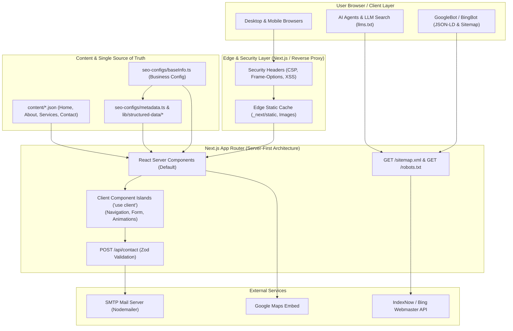
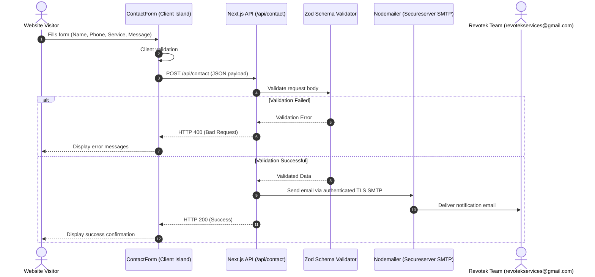

# Revotek Elevators — Comprehensive Project Documentation

A high-performance, SEO-first, production-grade web application built for **Revotek Elevators** (Ahmedabad, Gujarat, India). Engineered using **Next.js 16 (App Router, Turbopack)**, **React 19**, **Tailwind CSS v4**, **TypeScript**, and structured JSON-LD schemas for maximum search engine and LLM (GEO/AEO) discoverability.

---

## Table of Contents

1. [Project Overview](#1-project-overview)
2. [Business & Technical Requirements](#2-business--technical-requirements)
3. [System Architecture](#3-system-architecture)
4. [Directory & Module Structure](#4-directory--module-structure)
5. [SEO, Structured Data & AI Search (GEO)](#5-seo-structured-data--ai-search-geo)
6. [Security Architecture & Implementation](#6-security-architecture--implementation)
7. [API & Data Flow](#7-api--data-flow)
8. [Setup, Deployment & Operations](#8-setup-deployment--operations)

---

## 1. Project Overview

### 1.1 Business Identity
- **Company**: Revotek Elevators
- **Headquarters**: Shree Hari Darshan Industrial Park Rd, Phase IV, Vatva GIDC, Ahmedabad, Gujarat 382445, India
- **Primary Business**: Commercial, residential, hospital, and industrial vertical mobility solutions — including new elevator installations, periodic preventive maintenance, emergency repairs, modernization, Annual Maintenance Contracts (AMC), and OEM spare parts supply.
- **Contact Details**:
  - **Email**: `revotekservices@gmail.com`
  - **Phone Support**: `+91 98981 82761` (Harsh Jambekar), `+91 92659 99898` (Dilip Varlekar)
  - **WhatsApp Direct**: `https://wa.me/919265999898`
  - **Official Domain**: `https://www.revotekelevators.com`

### 1.2 Technology Stack
| Category | Technology | Version / Specification |
| :--- | :--- | :--- |
| **Framework** | [Next.js](https://nextjs.org/) (App Router, Turbopack) | `16.2.4` |
| **Runtime & Core** | [React](https://react.dev/) / [React DOM](https://react.dev/) | `19.2.4` |
| **Language** | [TypeScript](https://www.typescriptlang.org/) | `^5.0` |
| **Styling** | [Tailwind CSS v4](https://tailwindcss.com/) + `@tailwindcss/postcss` | `^4.0` |
| **UI Primitives** | [Base UI](https://base-ui.com/) / [shadcn/ui](https://ui.shadcn.com/) | `@base-ui/react ^1.4.1` |
| **Icons** | [Hugeicons React](https://hugeicons.com/) | `@hugeicons/react ^1.1.6` |
| **Animation** | [Framer Motion](https://www.framer.com/motion/) | `^12.38.0` |
| **Form Handling** | [TanStack React Form](https://tanstack.com/form) + [Zod](https://zod.dev/) | `zod ^4.4.2` |
| **Email Transport** | [Nodemailer](https://nodemailer.com/) | `^8.0.7` |
| **Font System** | `next/font` (Figtree) | Variable Google Font |

---

## 2. Business & Technical Requirements

### 2.1 Functional Requirements
- **Multi-Page Marketing Portal**: Fast loading static and dynamic marketing pages:
  - Homepage (`/`): Value proposition, services preview, feature highlights, FAQs, and contact calls to action.
  - About Us (`/about`): Company background, mission, vision, core values, and differentiation.
  - Services Catalog (`/services`): Overview of all vertical mobility solutions.
  - Service Detail Dynamic Pages (`/services/[slug]`): In-depth service breakdowns (specifications, process stages, FAQs, and quote request forms) for installations, maintenance, repair, modernization, AMC, and parts.
  - Contact Page (`/contact`): Interactive contact form, WhatsApp direct link, telephone numbers, and embedded Google Maps locator.
  - Legal Pages (`/privacy-policy`, `/terms-and-conditions`): Regulatory compliance and transparency.
- **Inquiry & Lead Generation**:
  - Validated contact and quote submission form.
  - Automated transactional email notification dispatched directly to `revotekservices@gmail.com`.
  - Direct WhatsApp click-to-chat integration for immediate on-field customer support.
  - Telephone `tel:` links enabling 1-click calls for mobile visitors.
- **Search Engine & AI Discovery**:
  - Full schema.org JSON-LD graph generation (LocalBusiness, Organization, Service, FAQPage, BreadcrumbList).
  - Dynamic OpenGraph and Twitter card previews (`opengraph-image.png`).
  - Native machine-readable index for LLMs and AI crawlers at `/llms.txt`.
  - Automated IndexNow search engine indexing submissions.

### 2.2 Non-Functional Requirements
- **Performance & Core Web Vitals**: Target 90+ Lighthouse scores across Desktop and Mobile by utilizing Server Components (RSC), Turbopack compilation, critical CSS inlining, and automatic modern image formats (`AVIF`/`WebP`).
- **Accessibility (a11y)**: WCAG AA adherence using semantic landmark elements (`<main>`, `<header>`, `<nav>`, `<footer>`, `<section>`, `<article>`), explicit form labelling, focus rings, and descriptive ARIA tags.
- **Type Safety**: End-to-end TypeScript compilation with `tsc --noEmit` and strict type validation for content and schema structures.
- **Reliability & Availability**: Decoupled static JSON architecture with zero external database dependencies during page renders, ensuring near 100% uptime and resilience against database outages.

---

## 3. System Architecture



### 3.1 Architectural Principles

1. **Server-First by Default (RSC)**: Pages are compiled and rendered on the server as React Server Components. Client-side JavaScript bundles are kept minimal by restricting `"use client"` exclusively to interactive controls (mobile drawer menus, animated hero sections, and form submission states).
2. **Single Source of Truth (SSOT)**: All core business identity values (business name, addresses, geolocation coordinates, telephone numbers, and email) are centralised in [baseInfo.ts](file:///d:/react-projects/revotek-new/seo-configs/baseInfo.ts). Metadata generators, layout components, and structured data builders all import from this single location.
3. **Decoupled Flat-File Content**: Content is stored in typed, version-controlled JSON files located in `content/`. This guarantees instantaneous page loads without database query latency and enables code review for all content updates.
4. **Islands Architecture for Interactivity**: Interactive elements (such as `ContactForm.tsx`, `Header.tsx` mobile drawer, and `ScrollToTopButton.tsx`) function as isolated client islands within a server-rendered DOM tree.

---

## 4. Directory & Module Structure

```
revotek-new/
├── .github/
│   └── workflows/
│       └── submit-sitemap.yml         # GitHub Actions automated sitemap submission
├── app/                               # Next.js 16 App Router directory
│   ├── layout.tsx                     # Root layout (fonts, header, footer, global JSON-LD)
│   ├── page.tsx                       # Homepage route
│   ├── not-found.tsx                  # Custom 404 page with semantic navigation
│   ├── manifest.ts                    # Web App Manifest generator
│   ├── robots.ts                      # robots.txt generator
│   ├── sitemap.ts                     # XML Sitemap generator
│   ├── opengraph-image.tsx            # Dynamic root OpenGraph image generator
│   ├── about/                         # About page route
│   ├── contact/                       # Contact & lead capture page
│   ├── services/                      # Services directory
│   │   ├── page.tsx                   # Services grid catalog
│   │   └── [slug]/                    # Dynamic service detail pages
│   └── api/                           # Backend API route handlers
│       ├── contact/route.ts           # Contact form submission handler (SMTP)
│       └── revalidate/route.ts        # On-demand cache revalidation & IndexNow ping
├── components/
│   ├── common/                        # Reusable site widgets (WhatsApp, ScrollToTop, Breadcrumbs)
│   ├── layout/                        # Global shell components (Header, Footer)
│   ├── section/                       # Section-specific views (Home, About, Services, Contact)
│   └── ui/                            # Low-level UI primitives (Button, Input, Textarea, Label, Separator)
├── content/                           # Flat-file JSON content repository
│   ├── about.json                     # About page textual data and value pillars
│   ├── contact.json                   # Contact page copy, form labels, and FAQs
│   ├── home.json                      # Hero banners, statistics, and testimonials
│   └── services.json                  # Complete service descriptions, specs, and process flows
├── lib/
│   ├── fonts.ts                       # Google Figtree font setup
│   ├── utils.ts                       # ClassName merging helper (clsx + tailwind-merge)
│   ├── indexing/indexnow.ts           # IndexNow API ping implementation
│   ├── og/OgTemplate.tsx              # JSX template for OpenGraph image generation
│   ├── seo/                           # Page metadata builder (buildPageMetadata.ts)
│   └── structured-data/               # JSON-LD Schema generators (Organization, WebPage, FAQ, etc.)
├── public/                            # Static public web assets
│   ├── assets/                        # Optimized WebP images, logos, and product brochure PDF
│   ├── favicon.ico                    # Standard favicon
│   └── llms.txt                       # Machine-readable documentation for AI search engines
├── scripts/
│   └── submit-sitemap.ts              # CLI script for manual search engine sitemap ping
├── seo-configs/
│   ├── baseInfo.ts                    # Core business details (Address, Phones, Email, Socials)
│   └── metadata.ts                    # Root metadata configuration and default Schema graph
├── next.config.ts                     # Next.js compiler, image, and HTTP header security policies
├── package.json                       # Dependencies and build scripts
└── tsconfig.json                      # TypeScript compiler configuration
```

---

## 5. SEO, Structured Data & AI Search (GEO)

### 5.1 JSON-LD Structured Data Graph
Search engines (Google, Bing, Yandex) receive structured data embedded in the HTML via `<script type="application/ld+json">`:
- **LocalBusiness / Organization**: Declares business legal name, verified physical address, geo-coordinates, hours of operation, telephone numbers, and official contact email (`revotekservices@gmail.com`).
- **Service Schema**: Each service under `/services/[slug]` outputs dedicated `Service` and `Offer` schema definitions.
- **FAQPage Schema**: FAQs on the home page and service pages output structured Question/Answer nodes eligible for rich search results.
- **BreadcrumbList**: Enables hierarchical breadcrumb links in search snippets.

### 5.2 Generative Engine Optimization (GEO / AEO)
To ensure the website is indexed accurately by Large Language Models and AI search systems (e.g., ChatGPT, Perplexity, Gemini):
- [`public/llms.txt`](file:///d:/react-projects/revotek-new/public/llms.txt) provides a plain-text markdown summary of corporate identity, core capabilities, direct inquiry contacts, and official service URLs.
- The root layout links directly to this document using `<link rel="llms" type="text/plain" href="/llms.txt" />`.

---

## 6. Security Architecture & Implementation

### 6.1 HTTP Response Security Headers
Configured in [`next.config.ts`](file:///d:/react-projects/revotek-new/next.config.ts) and applied to all incoming web requests:

```typescript
{
  key: "X-Content-Type-Options",
  value: "nosniff"                     // Prevents MIME-sniffing exploits
},
{
  key: "X-Frame-Options",
  value: "SAMEORIGIN"                  // Mitigates clickjacking attacks
},
{
  key: "Referrer-Policy",
  value: "strict-origin-when-cross-origin" // Protects internal referrer data
},
{
  key: "Permissions-Policy",
  value: "camera=(), microphone=(), geolocation=()" // Disables unused browser hardware
},
{
  key: "X-XSS-Protection",
  value: "1; mode=block"               // Activates browser-level XSS filtering
}
```

### 6.2 External Link Security
All outbound links (to Google Maps, WhatsApp, and social media channels) strictly use:
```html
target="_blank" rel="noopener noreferrer"
```
This isolates the window context, preventing malicious target pages from running reverse tab-nabbing scripts via `window.opener`.

### 6.3 Input Validation & Form Sanitization
Contact inquiries pass through strict dual-layer validation powered by **Zod**:
1. **Client-Side** (`components/section/contact/ContactForm.tsx`): Immediate user feedback preventing invalid submissions before network requests are dispatched.
2. **Server-Side** (`app/api/contact/route.ts`):
   ```typescript
   const contactSchema = z.object({
     name: z.string().min(2),
     phone: z.string(),
     email: z.string().optional(),
     elevatorName: z.string(),
     elevatorCount: z.string(),
     basementCount: z.string(),
     floorCount: z.string(),
     passengerCapacity: z.string(),
     message: z.string().min(10),
   });
   ```
   Payloads failing validation are rejected immediately with HTTP 400 Bad Request without touching mail systems.

### 6.4 Environment Variables & Secret Segregation
- Sensitive credentials (SMTP user, password, server port, and external API keys) reside in `.env` / `.env.local` which is strictly ignored by Git.
- Only variables explicitly prefixed with `NEXT_PUBLIC_` are exposed to client browser bundles.

### 6.5 Safe Media Handling
- Next.js image optimization has `dangerouslyAllowSVG: false` to eliminate risks of inline SVG XML Entity or Cross-Site Scripting (XSS) injection.
- Images are served strictly from validated local paths.

---

## 7. API & Data Flow

### 7.1 Contact Form Submission (`POST /api/contact`)



### 7.2 On-Demand Cache Revalidation (`POST /api/revalidate`)
- Secure endpoint protected by secret token verification.
- Revalidates static page cache without requiring a full application redeploy.
- Submits updated URLs to search engines via the IndexNow API protocol.

---

## 8. Setup, Deployment & Operations

### 8.1 Prerequisites
- **Node.js**: `v20.x` or `v22.x` (LTS recommended)
- **Package Manager**: `pnpm` (version `10.x` or `11.x`)

### 8.2 Environment Configuration
Create a `.env.local` file from the provided `.env.example`:

```bash
# SMTP Configuration
SMTP_HOST=smtpout.secureserver.net
SMTP_PORT=465
SMTP_SECURE=true

# Email Authentication
SMTP_USER=info@revotekelevators.com
SMTP_PASS=your_smtp_password

# Email Destination & Settings
SMTP_FROM_EMAIL=info@revotekelevators.com
CONTACT_EMAIL=revotekservices@gmail.com

# Site URL
NEXT_PUBLIC_SITE_URL=https://www.revotekelevators.com

# Indexing APIs
INDEXNOW_API_KEY=your_indexnow_key
BING_WEBMASTER_API_KEY=your_bing_key
```

### 8.3 CLI Commands

| Command | Purpose |
| :--- | :--- |
| `pnpm install` | Installs project dependencies |
| `pnpm dev` | Starts Turbopack local development server at `http://localhost:3000` |
| `pnpm build` | Compiles optimized production build with Turbopack |
| `pnpm start` | Launches Node.js production server |
| `pnpm exec tsc --noEmit` | Runs full static TypeScript type checks |
| `pnpm run submit-sitemap` | Submits sitemap to Google, Bing, and IndexNow endpoints |

